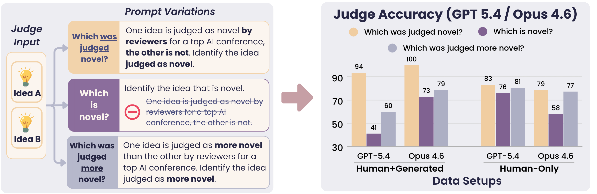
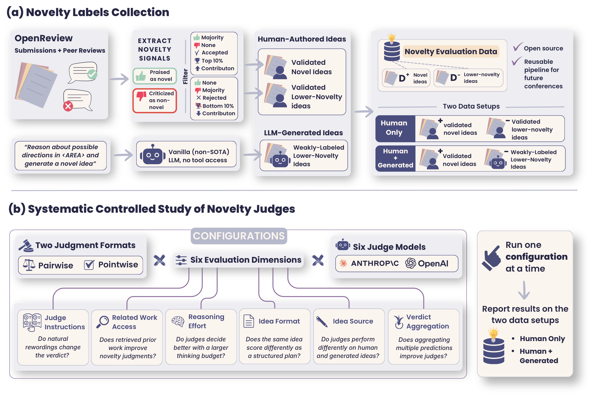
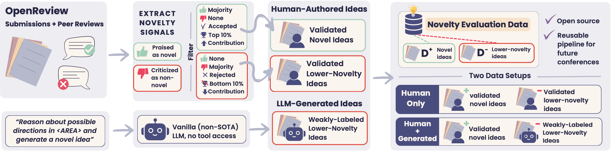
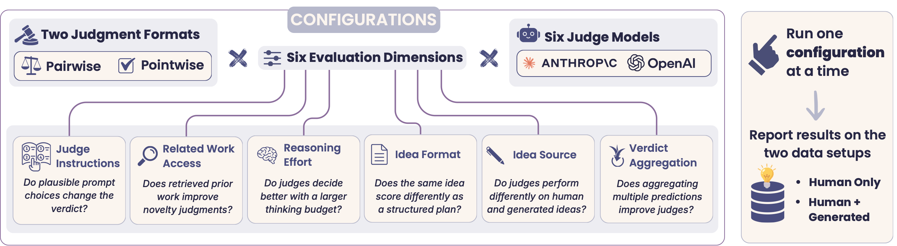

# Old Ideas, Novel Problems:<br> The Instability of LLM-Based Novelty Evaluation

[](https://arxiv.org/abs/2610.02022)
[](https://www.python.org/)
[](https://huggingface.co/datasets/allenai/novelty-judge-bench)

<!-- [](https://noy-sternlicht.github.io/Novelty-Evaluation-Web/) -->


<p align="center">
  
</p>


AI-based ideation systems are often evaluated on the novelty of their ideas, and that judgment is increasingly delegated to large language models. Such judges are typically built ad hoc and validated, if at all, on human-authored papers rather than on the generated ideas they are meant to score. So, how do novelty judges perform?

Not well. We present a systematic controlled study of novelty evaluation design choices. We build an evaluation set automatically, mining OpenReview for passages where reviewers explicitly affirm or dispute a paper's originality and keeping only submissions with unanimous agreement at the extremes of their research area; we pair these with ideas from a vanilla LLM generator. Across six judges, we find that seemingly small prompt design choices have large consequences; e.g., simply telling the judge that reviewers found one idea novel and the other not can change its verdict on more than half of the identical idea pairs it is shown, shifting pairwise accuracy by over 50 points and occasionally pushing it below chance. The same change helps one judge and hurts another. Retrieval and larger reasoning budgets help little, and two purpose-built novelty evaluators are outperformed by our cheapest prompted baseline. These results raise questions about reported novelty gains of automated ideation systems, and call for robust novelty evaluation methods.


<!-- <p align="center">
  
</p> -->

## Table of Contents

<!-- TOC -->
- [Old Ideas, Novel Problems: The Instability of LLM-Based Novelty Evaluation](#old-ideas-novel-problems-the-instability-of-llm-based-novelty-evaluation)
  - [Table of Contents](#table-of-contents)
  - [Getting started](#getting-started)
    - [Setting up API keys](#setting-up-api-keys)
  - [Novelty Evaluation Data](#novelty-evaluation-data)
    - [🤗 Hugging Face](#-hugging-face)
    - [Expert Annotation of Judge Errors](#expert-annotation-of-judge-errors)
    - [Automatic Data Collection](#automatic-data-collection)
  - [Judge Evaluation](#judge-evaluation)
  - [Reproducing the Paper's Experiments](#reproducing-the-papers-experiments)
    - [Controlled study](#controlled-study)
    - [Retrieval's limitations](#retrievals-limitations)
    - [Dedicated novelty judges](#dedicated-novelty-judges)
  - [License](#license)
  - [Authors](#authors)
  - [Cite us!](#cite-us)
<!-- TOC -->

## Getting started

1. Clone this repository:
   ```bash
   git clone https://github.com/allenai/novelty-eval.git
   cd novelty-eval
   ```
2. Create and activate a virtual environment:
   ```bash
   python3.12 -m venv myenv
   source ./myenv/bin/activate
   ```
3. Install dependencies:
   ```bash
   pip install -r requirements.txt
   ```
4. Point the code at the repository:
   ```bash
   export PYTHONPATH="$PWD/src"
   export SECRETS="$PWD/secrets.toml"
   export OUTPUT_DIR="$PWD/output"
   ```

If you plan to commit changes, register the notebook filter so that running a notebook (outputs, execution counts, kernel metadata) doesn't show up as a change (needs `jq`):

```bash
git config filter.nbstrip.clean 'jq --indent 1 -f scripts/nbstrip.jq'
git config filter.nbstrip.smudge cat
git config filter.nbstrip.required true
```

### Setting up API keys

The judges and the benchmark-construction pipeline call external APIs. Keys go in a `secrets.toml` file at the project root (the location `$SECRETS` points at):

```toml
openai_key = "your-openai-api-key"
anthropic_key = "your-anthropic-api-key"
semantic_scholar_key = "your-s2-api-key"   # retrieval only
```

Rebuilding the benchmark from scratch additionally needs OpenReview credentials:

```bash
export OPENREVIEW_USERNAME="your-openreview-email"
export OPENREVIEW_PASSWORD="your-openreview-password"
```

## Novelty Evaluation Data

<p align="center">
  
</p>

Our benchmark consists of two data setups: **Human-Only** and **Human+Generated**. Both setups consist of two separate idea "pools": a **high-novelty pool `D_+`** and a **lower-novelty pool `D_-`**, where ideas from `D_+` can be assumed to be more novel than those in `D_-`.

| Setup | `D_+` (novel) | `D_-` (lower-novelty) |
|---|---|---|
| **Human-Only** (`data/human-only/`) | 154 **validated-novel** | 145 **validated-lower-novelty** |
| **Human+Generated** (`data/human-plus-generated/`) | 154 **validated-novel** | 154 **weakly-labeled-lower-novelty** |

Where:
* **validated-novel** (both setups) — ICLR 2026 submissions whose reviewers explicitly praised the originality of the contribution itself and none disputed it; accepted, in the top rating decile of their primary area, with an average contribution score >= 3.0.
* **validated-lower-novelty** (Human-Only) — the mirror image: reviewers faulted the originality and none praised it; rejected, in the bottom rating decile of their primary area, with an average contribution score <= 2.0.
* **weakly-labeled-lower-novelty** (Human+Generated) — ideas from Claude Sonnet 4.5, prompted simply to propose a novel idea with no scaffold, literature access, or tools.

Each setup is instantiated in two evaluation formats:

* **pointwise** — one idea per row, binary label: is this idea novel?
* **pairwise** — one `D_+` idea against one `D_-` idea; which of the two is more novel?

and in two idea formats:

* **abstract** (default) — the idea as a free-form abstract.
* **plan** (`*_plan` configs) — the same ideas normalized into a two-field *purpose* / *mechanism* research plan.

`data/human-plus-generated/backbone-*/` regenerates `D_-` with other ideation backbones (`gpt-5`, `gpt-5.1`, `gpt-5.4`, `opus-4-5`) and is used in the negatives-source experiment.

### 🤗 Hugging Face

Code in this repo is designed to work with the YAML files in `data`, but we also release the same instances on the Hub: [allenai/novelty-judge-bench](https://huggingface.co/datasets/allenai/novelty-judge-bench).

```python
from datasets import load_dataset

ds = load_dataset("allenai/novelty-judge-bench", "human-plus-generated_pointwise", split="test")
```

### Expert Annotation of Judge Errors

[`data/expert-annotations/judge_errors.csv`](data/expert-annotations/judge_errors.csv) holds 30 pairwise instances re-judged blind by a domain expert: 28 the LLM judge got wrong and 2 controls it got right. The expert sided with the benchmark's gold label on all 30, and explains each choice in `annotation_reasoning`. See [data/README.md](data/README.md#expert-annotations) for further information.

### Automatic Data Collection

The same pipeline that produced these files can be re-run on a newer conference cycle. See instructions here:

[**Rebuilding the benchmark**](src/novelty_eval/benchmark_data/README.md)


## Judge Evaluation

[example_eval.yaml](src/novelty_eval/config/example_eval.yaml) runs a single judge over a single released benchmark file, under the baseline configuration of the paper: a verdict plus reasoning, three samples per decision, high reasoning effort, no tools, and no related work.

```bash
python src/novelty_eval/run_benchmark.py \
    --config src/novelty_eval/config/example_eval.yaml
```

## Reproducing the Paper's Experiments

<p align="center">
  
</p>

Every experiment takes three steps:

1. **Run** the controlled changes: `./scripts/eval/run_ablations.sh --skip-create --models <key>,<key>,... --parallel-models --tracks <key>,<key>,... --ablations <key>,<key>,...`. Controlled changes (ablations) are defined in [ablations.yaml](src/novelty_eval/ablation/ablations.yaml). Adding `--batch` runs experiments in API batch mode (half the price).
2. **Merge** results for different controlled changes and compute statistical significance: `python src/novelty_eval/ablation/merge_ablation_runs.py --config <merge config>`. The configs in [configs/merge/](src/novelty_eval/ablation/configs/merge/) list *our* run directories under `dirs:`, so replace them with yours.
3. **Plot** with the notebook listed below.

In key and config names, `hvh` is **Human-Only** and `vanilla` is **Human+Generated**.

### Controlled study

| Paper | `ablations.yaml` key |
|---|---|
| Reference configuration | `current` |
| P1: Criteria without guardrails | `vague_criterion` |
| P2: Criteria removed | `no_criteria_prompt` |
| P3: "Which was judged novel?" | `ai_researcher_base` |
| P4: "Which is novel?" | `ai_researcher_no_review` |
| P5: "Which was judged more novel?" | `ai_researcher_comparative` |
| + Related work (retrieval) | `retrieval` ¹ |
| Reasoning effort = low | `low_judge_reasoning` |
| Idea format | `convert_to_plan_form_{pairwise,pointwise}_{human,vanilla}` |
| No verdict aggregation | `mec_k_1` ² |
| D₋ source | `{gpt_5,gpt_5.1,gpt_5.4,opus-4-5}_backbone_{pairwise,pointwise}_vanilla` |

¹ Needs a retrieval cache first: [run_retrieve_candidates.sh](src/novelty_eval/retrieval/run_retrieve_candidates.sh) builds it for pairwise, and [flatten_retrieval_cache.py](src/novelty_eval/retrieval/flatten_retrieval_cache.py) derives the pointwise cache from it.<br>
² Not a separate run. [derive_subrun_artifacts.py](src/novelty_eval/ablation/derive_subrun_artifacts.py) carves it out of the `current` runs.

Merge with [merge_config_hvh.yaml](src/novelty_eval/ablation/configs/merge/merge_config_hvh.yaml) and [merge_config_vanilla.yaml](src/novelty_eval/ablation/configs/merge/merge_config_vanilla.yaml), then plot:

| Figure / table | Notebook |
|---|---|
| Controlled-change results, plus the soft-accuracy and per-class F1 versions in the appendix | [two_track_figure.ipynb](src/novelty_eval/figures/two_track_figure.ipynb) |
| Tie rates (figure and table) | [tie_rates_figure.ipynb](src/novelty_eval/figures/tie_rates_figure.ipynb) |
| Effect of the lower-novelty ideas source | [negatives_source_figure.ipynb](src/novelty_eval/figures/negatives_source_figure.ipynb) |
| Controlled-change results without verdict aggregation ³ | [sampling_depth_figure.ipynb](src/novelty_eval/figures/sampling_depth_figure.ipynb) |

³ Derive the single-sample version of every ablation with `derive_subrun_artifacts.py`, then merge with [configs/merge/mec_k1/](src/novelty_eval/ablation/configs/merge/mec_k1/).

### Retrieval's limitations

* **Strong agentic RAG judge**: run `./scripts/eval/run_retrieval_faceoff.sh sample`, then `submit`, then `poll`. Plot with [retrieval_faceoff_figure.ipynb](src/novelty_eval/figures/retrieval_faceoff_figure.ipynb).
* **Retrieval across ideation backbones** (appendix): run the `{gpt_5.1,gpt_5.4,opus-4-5}_backbone_retrieval_{pairwise,pointwise}_vanilla` ablations, merge with [configs/merge/retrieval_given_backbone/](src/novelty_eval/ablation/configs/merge/retrieval_given_backbone/), and plot with [retrieval_given_backbone_figure.ipynb](src/novelty_eval/figures/retrieval_given_backbone_figure.ipynb).

### Dedicated novelty judges

We ran [AI-Scientist](https://arxiv.org/abs/2408.06292) and [Idea-Novelty-Checker](https://arxiv.org/abs/2506.22026) with the implementations released at [simra-shahid/idea_novelty_checker](https://github.com/simra-shahid/idea_novelty_checker). That code is not part of this repository.

[cost_efficiency.ipynb](src/novelty_eval/figures/cost_efficiency.ipynb) draws the cost vs. macro-F1 figures and the pointwise results table. Point it at your run directories first.

A file-by-file map of the codebase lives in [src/novelty_eval/README.md](src/novelty_eval/README.md).

## License

The code is licensed under [Apache 2.0](LICENSE). The data in [`data/`](data/) is licensed
under [ODC-BY 1.0](data/LICENSE); see [data/README.md](data/README.md#license) for the OpenReview
attribution and model-output terms that apply to it.

## Authors

- [Noy Sternlicht](https://noy-sternlicht.github.io/) — Hebrew University of Jerusalem, Allen Institute for AI
- [Simra Shahid](https://sites.google.com/view/simra-shahid/home) — Microsoft
- [Peter Jansen](https://cognitiveai.org/) — Allen Institute for AI, University of Arizona
- [Daniel S. Weld](https://www.cs.washington.edu/people/faculty/weld/) — Allen Institute for AI, University of Washington
- [Pao Siangliulue](https://paoponder.com/) — Allen Institute for AI
- [Tom Hope](https://tomhoper.github.io/) — Hebrew University of Jerusalem, Allen Institute for AI

## Cite us!

```bibtex
@misc{sternlicht2026oldideasnovelproblems,
      title={Old Ideas, Novel Problems: The Instability of LLM-Based Novelty Evaluation}, 
      author={Noy Sternlicht and Simra Shahid and Peter Jansen and Daniel S. Weld and Pao Siangliulue and Tom Hope},
      year={2026},
      eprint={2610.02022},
      archivePrefix={arXiv},
      primaryClass={cs.CL},
      url={https://arxiv.org/abs/2610.02022}, 
}
```

